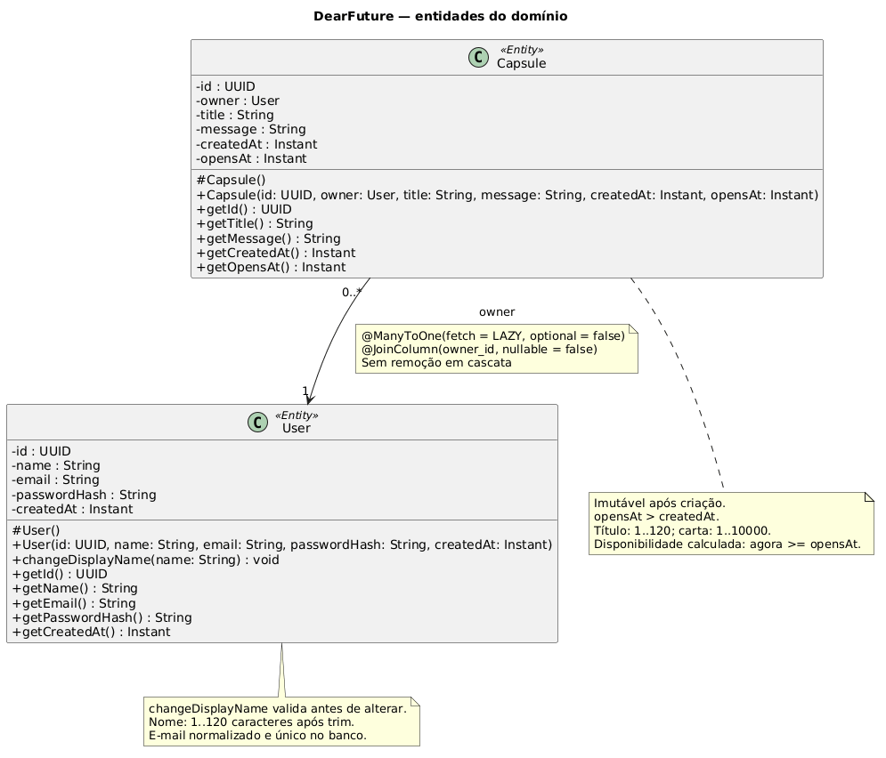

# DearFuture — Backend

API de cápsulas do tempo privadas por usuário. Frontend: [dearFuture](https://github.com/sofl-aline/dearFuture).

## Status e arquitetura

Etapa implementada: entidades `User` e `Capsule`, repositories JPA, migrações Flyway, resumo de cápsulas, política temporal e configuração de segurança JWT/CORS. Os Controllers e Services funcionais serão implementados posteriormente.

O projeto utiliza arquitetura em camadas, organizada por funcionalidade (`internal/auth` e `internal/capsule`). Cada funcionalidade separa entidades, repositories, DTOs e, nas próximas etapas, services e controllers. Configurações ficam em `config` e exceções comuns em `shared/exception`.

Essa organização atende ao domínio pequeno de cápsulas privadas, mantendo uma única aplicação e um banco de dados. Evita a complexidade operacional de múltiplos serviços e deixa claras as responsabilidades de persistência, regras e HTTP.

## Modelagem do domínio

As duas entidades do MVP são `User` e `Capsule`. As [regras de negócio](docs/REGRAS-DE-NEGOCIO.md) definem invariantes, comportamentos e responsabilidades das próximas etapas. O usuário pode alterar seu nome por `changeDisplayName`; cápsulas são imutáveis após a criação.

O diagrama apresenta atributos, tipos, construtores, métodos e multiplicidades. O [arquivo editável PlantUML](docs/uml/dominio.puml) também está disponível no repositório.



## Executar

Requisitos: JDK 21, OpenSSL e acesso à internet para baixar dependências na primeira execução.

```sh
java -version
# No macOS, selecionar Java 21 também para o Maven:
export JAVA_HOME="$(/usr/libexec/java_home -v 21)"
sh scripts/generate-keys.sh
./mvnw verify
./mvnw spring-boot:run
```

A geração das chaves é feita uma vez por clone e recusa sobrescrever arquivos existentes.
No Windows, usar Git Bash para o script e `mvnw.cmd` para Maven.
Se ainda estiver montando a etapa zero, gerar o wrapper com Maven instalado:

```sh
mvn -N org.apache.maven.plugins:maven-wrapper-plugin:3.3.4:wrapper -Dmaven=3.9.11 -Dtype=only-script
```

API: `http://localhost:8080/api/v1`. Frontend permitido: `http://localhost:5173`.
Banco local em `data/`, preservado após reinícios. Testes usam H2 em memória.
Não apagar `data/` para resolver migrações sem entender a consequência para os dados.

## Configuração

| Variável | Padrão |
| --- | --- |
| `SERVER_PORT` | `8080` |
| `DB_URL` | `jdbc:h2:file:./data/dearfuture` |
| `DB_USERNAME` | `sa` |
| `DB_PASSWORD` | vazia, somente para demonstração local |
| `CORS_ORIGINS` | `http://localhost:5173` (múltiplas origens separadas por vírgula) |
| `JWT_PUBLIC_KEY` | `file:./secrets/public.pem` |
| `JWT_PRIVATE_KEY` | `file:./secrets/private.pem` |

Spring não carrega um `.env` automaticamente nesta configuração. Exportar variáveis no terminal ou configurar a IDE.
Não versionar chaves privadas, tokens, cartas reais, senhas ou o banco.
Testes locais também exigem executar o script de chaves. O CI gera chaves descartáveis.

## Autenticação e privacidade

Cadastro, login e endpoints entram nos PRs de funcionalidades após a base.
Todas as rotas de cápsulas exigem Bearer JWT. A base já bloqueia acesso anônimo.
Tokens duram 15 minutos, sem refresh token. O frontend deve manter token somente em memória.
Logout no frontend descarta token e dados; token previamente copiado permanece válido até expirar.
Sem recuperação de senha, administração ou compartilhamento no MVP.
A carta só é liberada ao proprietário no instante de abertura ou depois dele.

O contrato completo será publicado em `docs/api.md` .
A validação deve incluir duas contas e chamada direta à API, além da interface.
A demonstração local não deve ser publicada sem HTTPS e controles adicionais de acesso/login.

## Equipe

- Aline Silva Oliveira de Figueiredo Lima
- Mateus Cavalcante de Lima
- José Vasconcelos de Carvalho Neto
- Rafaella Porto
- Romulo Frade Cardoso Fernandes
- 
Cada integrante trabalha em branch própria, com commits individuais e PRs revisados.
